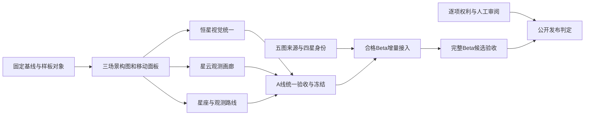

**Solar Sim Mainline A 美术主线规划｜2026-10-14**

本规划依据“宇宙开发美术”（01a09e1f-da8f-77a3-83ac-96830effa409）近期交付与决策、后续“Solar Sim 美术主线 · GPT-6 Astra · R81”（01a135e7-18ba-7c43-bda2-3a4d778bc8bb）、当前本地源码和 R80 留存画面制定。本次只新增规划文档，没有修改运行时代码、恢复其他聊天、创建 goal、重新构建或部署。

**建议把下一阶段的主交付固定为：现有天体拥有统一画面语言，能完成一条连贯的观测旅程，并在桌面和窄屏上保持主体清楚。** 外部来源、恒星组件身份和权利审核从第一天并行推进。最终 Beta 24 恒星／12 星座／24 星云目标保留；阶段性 A 线验收不冒充完整 Beta 完成。

本计划不再用“再做几轮”作为完成定义。历史 R 编号继续作为实施记录，下面的 M0–M5 是固定工作包，不代表已经实施的新轮次。

**事实基线及其适用范围。** 已核对内部 Git 根目录为 next-web，分支 codex/solar-sim-mainline-a，HEAD 为 156ec77。现场有 63 个已跟踪修改和 2 个既有删除，并有大量未跟踪成果；提交号不足以代表这些工作内容。没有操作上级仓库，也没有恢复或覆盖已有文件。

| 维度 | 核对到的证据 | 不能由此推出的结论 |
|---|---|---|
| 完整轮次 | 最新找到的完整 round 为 R80/V667；R81 执行中断，仅见 preflight 与来源捕获 | R81 已完成或当前源码已通过新验收 |
| A 线覆盖 | R80 的运行时矩阵为 12 恒星、12 星座、12 星云 | 全部 Beta 对象已进入运行时 |
| Beta 覆盖 | 24／12／24 审查条目；恒星界面有 20 个现有运行时参考和 4 个 hold | 24 颗恒星全部准入；这些计数可与 A 线直接相加 |
| 图像 | A 12 + Beta 19 共 31 条本地可请求影像；Beta 5 条 hold | 每张影像都适合主视觉或已取得逐项权利签收 |
| 技术验收 | R80 记录 Node 37/37、Vitest 49/49、定向 ESLint、生产构建、HTTP 与浏览器通过 | 历史构建通过可以沿用到新源码 |
| 视觉覆盖 | 137 张截图有哈希记录，8 张曾由代理抽查 | 全部对象已经逐项人工美术验收 |
| 权利 | A 星云签收 0/12，Beta 0/24 | 可以公开发布或将官方来源自动视为已授权 |
| 性能 | R80 只有短测；R78 的两次约 30 分钟长测属于更早源码 | 最终版本长时性能已经关闭 |
| 本次规划 | 实际查看 R80 桌面 Sirius、Ori、M42 和移动 M42；并审计相关组件 | 本次启动了当前实时页面，或完成全量视觉检查 |

R80 的源码指纹为 5197fc3dcc073ff95b859091da38415c596a85a28c44c32cd1b4f0530c238dd6，构建 ID 为 OzXlBUCmLBXsMtceBdR7h。它们用于定位历史证据，不作为本轮新通过结论。旧迭代计划开头的 R48“20／12／12”与 design-qa.md 中 v587 Kerr 局部舞台验收均有各自范围，不覆盖当前 Mainline A 全部对象。

**目前最值得解决的是可见的画面问题。** 在已查看的 R80 截图中，Sirius 主场景球体与档案内参数化肖像的色调、纹理不同；M42 同时出现主场景图、右侧预览和大说明卡，主体被分散；Ori 主场景与档案图使用两套线条强调方式；移动 M42 被尺度栏、浮动按钮、影像说明和档案底板共同挤压。这些是留存画面的观察，实施前应在同一构建上重现。

| 画面问题 | 对用户的影响 | 首选改法 |
|---|---|---|
| 同一天体有两个竞争的主图 | 视线没有明确落点，容易怀疑图像表达是否一致 | 主舞台负责观看，档案负责事实与操作；完整第二主图仅在主动比较时出现 |
| 星云大说明卡占据焦点区域 | 观测图显得小，说明比天体更抢眼 | 一行常驻对象／影像性质／署名入口；详情展开后查看完整文字 |
| 移动端多层同时展开 | 主体被遮挡，返回与展开动作不明确 | 单一底部面板，折叠、半屏、详情三种状态；浮动操作让开图像 |
| 主场景与图卡视觉不统一 | 恒星、星座像来自不同产品 | 共享呈现参数与选中语义，并保留不同视图的合理缩放 |
| 内部版本号与证据术语进入普通浏览 | 用户先看到工具状态，难以开始探索 | 普通界面用“艺术示意／观测影像／来源待审”；SHA、版本与审计细节进入来源视图 |

来源入口与必要署名仍可达；任何状态折叠都不能隐藏影响用户判断的“候选、艺术示意、二维观测、待审”含义。

**视觉方向沿用项目已有的深色观测台。** 使用近黑背景、克制的青色导航与暖色选中提示，保留大面积暗场和清晰星点。让真实星云影像提供丰富色彩，避免再叠一层统一的紫蓝滤镜。UI 的装饰亮度低于被选天体，银河背景在聚焦状态退后；科学数据和展示增益分离。

外部参照用于确定交互与语义：NASA Eyes 展示了由目录支撑的可探索三维宇宙；ESA Gaia Sky 展示位置、运动、亮度与颜色等多维数据；IAU 将星座定义为有边界的天空区域。因此本项目的连线、人物插画和正式边界应保留不同开关与说明。具体布局与美术参数仍由本项目样板决定，不直接复制这些产品。[NASA Eyes](https://science.nasa.gov/exoplanets/eyes-on-exoplanets-web/) · [ESA Gaia Sky](https://www.cosmos.esa.int/en/web/gaia/gaiadr2_gaiasky) · [IAU 星座说明](https://www.iau.org/IAU/IAU/Astronomy-FAQs/Constellations.aspx?hkey=bb9dc841-0618-41b5-ac70-149741062141)

| 层次 | 设计约定 | 约束 |
|---|---|---|
| 全景天空 | 位置、尺度、当前选择与少量关键标签优先 | 不为构图改变目录位置或物理距离 |
| 聚焦舞台 | 一个天体主角；镜头与面板让出可用画幅 | 归一化肖像要明确说明，不能伪称真实角径 |
| 恒星肖像 | 色温、临边、光晕、形态族有稳定差异 | 纹理是参数化艺术表达，不能当观测表面 |
| 星座 | 轮廓、关键星、周边星三个层次 | IAU 边界、星座连线、艺术图形不能互相冒充 |
| 星云 | 保留原始构图和配色，按需放大，署名可达 | 二维影像不伪造成具备科学深度的体积模型 |
| 动效 | 聚焦、返回、选中有统一节奏，支持打断与减少动画 | 不覆盖相机控制权、不影响科学计算、不强迫观看长动画 |
| 移动 | 主图与单一底板协调，关闭详情能迅速回到观测 | 模拟视口通过不能写作实体手机通过 |

以下是样板阶段的起始设计参数，需用实际画面校准；它们不修改天空坐标、物理尺度或科学参数。

| 项目 | 起始方案 | 样板检查方法 |
|---|---|---|
| 桌面详情 | 1280px 视口下详情宽约 320–360px；完整影像不在两处同时抢占主视觉 | 并排看三场景，开关详情时主角仍完整，焦点不跳变 |
| 聚焦构图 | 归一化恒星肖像直径先取可用舞台短边的 45%–60%；星云以完整图适配可用区域 | 不把该尺寸解释为真实角径；保留星云全图、细节查看与返回 |
| 移动底板 | 折叠态约 88–112px，半屏态不超过约 45dvh；完整详情不超过 80dvh 且可滚动 | 360–430px 宽度下只有一个主面板，操作不压住天体关键区域 |
| 文字与操作 | 正文先取 14–16px，重要触控目标至少 44px；技术标识退出主标题层 | 实际查看长中英名称、来源署名和焦点状态，不仅检查无溢出 |
| 过渡 | 面板约 180–240ms，选中约 200–350ms，短距离聚焦约 600–1000ms | 快速连续选择能打断；远距离尺度切换单独设计；减少动画时省略非必要运动 |

**以三幅样板约束后续工作。** 第一批选择 Sirius A、Orion、M42，分别对应恒星、星座、星云；固定桌面与移动视口、对象、镜头和状态，保存六张新旧对照。样板必须来自实际运行的页面。首轮以 1280×720 和 390×844 对齐历史证据，冻结验收再加入 1440×900、窄至 360px 与必要的中间宽度。

样板审看回答五件事：主体是否明确；颜色和材质是否一致；文字层级是否清楚；下一步操作是否易懂；来源和艺术边界是否易查。每项记录通过或具体修改意见。代理视觉检查与用户审阅分开记录；用户未审阅就写 pending，不代签。样板评语变成同类对象的验收依据，后续不重新发明风格。

**M0–M5 是固定实施顺序，外源工作独立并行。**

| 工作包 | 用户可以看到的结果 | 核心工作与复用 | 退出条件 | 规划工时 |
|---|---|---|---|---:|
| M0 基线固定 | 一份短清单明确现状和本轮要改的画面 | 核对 R81 未完成项；重现三样板；保存改动前图；固定对象与状态 | 不把旧图当当前，列出具体画面缺陷与范围 | 2–4h |
| M1 构图与面板 | 三种天体都拥有清楚的视觉主角，移动不再多层抢画面 | 统一聚焦态、档案主次、底板状态、来源入口、普通用户文案 | 六个样板视图通过代理检查；开合、返回、键盘与触摸目标可用；人审另记 | 8–12h |
| M2 恒星语言 | 从蓝热星到红巨星、快速自转星，外观有辨识度 | 先校准 Sirius、Betelgeuse、Vega、Achernar 等现有对象；复用 v596 形态合同，让场景与卡片共享表现配置；推广到 A 12 | 同对象颜色族一致，近景纹理与光晕协调；没有把艺术细节当测量；4 个待审恒星不晋级 | 8–12h |
| M3 星云画廊 | 星云影像成为主体，观看、放大和查来源自然连贯 | 先用 A 线高质量影像定构图；复用纹理租约、加载与取消管线；统一 12 图；候选预览按质量区分 | 不拉伸、不偷偷裁去信息；图片切换无串图；加载失败、重试、关闭均正确；不把拼图当精品主图 | 6–10h |
| M4 星座旅程 | 从猎户座进入关键恒星或 M42，再返回星座 | 复用 J2000 锚点、IAU 边界和已有五条路线；先完成 3–5 站猎户座路线，再统一 A 12 星座选择态 | 前进、后退、打断、恢复视点可用；连线与边界可区分；标签不遮主角 | 6–10h |
| M5 集成与冻结 | 可交给用户完整走一遍的 A 线网页候选 | 整合 36 场景、真实问题修复、同构建矩阵、两次长测、来源入口与候选包 | 功能与自动验收关闭；人工未审、权利未签仍列出；无新增范围；形成明确冻结结论 | 10–16h |

上述合计 **40–64 个有效工程小时**，含集成与验证的规划余量，不含外部等待和用户审阅等待。这是范围估算，不是已测得的实施速度。M1 后仅根据实际耗时、发现的问题和余下清单更新一次估算差额；不把进度重新计作“还要若干轮”。

**完整 Beta 的扩展在样板和 A 线稳定后进行。** 保留 24／12／24 最终目标，把已具备条件的对象按同一视觉合同接入；每个新对象必须完成来源、身份、表现、失败态与释放检查。预计另需 16–32h 工程工作，完整候选预算可取 **60–100h**，仍不含取得外部证据的等待。缺失对象不以替换名字、合成响应或增加条目数来抵消；若希望换对象，需要明确调整产品范围。

**五条图像链按对象处理，避免重复建设采集平台。** 旧数据里的 oldItemPolicyBlockers 是继承的策略标记，不是这次规划给出的法律结论。R74 已有六个官方页面、五个身份候选及一个冲突页；候选图片请求数为零，因此不能统称为五次下载失败。

| 对象 | 现有线索 | 下一项有效行动 | 保持 hold 的条件 |
|---|---|---|---|
| Ring／环状星云 | Photojournal PIA07343 | 对新候选逐项核对来源、署名、适用条件和可用原图；不直接沿用旧条目判断 | 无可采信原图、画质不足或权利判断未完成 |
| Dumbbell／哑铃星云 | Hubble M27/NGC6853 优先 | 排除 target 实为 Helix 的旧 Spitzer PIA14417 页面；采集正确对象图像并核对 | 身份仍冲突、素材不足或审核缺项 |
| Bubble／气泡星云 | Hubble mosaic/infographic 线索 | 先确认下载是观测图还是信息图/拼版，再决定是否适合主视觉 | 仅有说明拼版、分辨率不足或来源条件未闭合 |
| Cat’s Eye／猫眼星云 | PIA11827、NGC6543 | 复用采集器获取隔离候选原图，核对字节、目标和署名 | 未取得原图、目标或权利尚未核实 |
| Omega／欧米伽星云 | PIA12071、M17，credit 含合作机构 | 查清该图完整署名和适用条件，再建立候选素材链 | 合作方条件未明、原图未验或未签收 |

每张图完成“官方对象匹配 → 条目级来源与使用条件核对 → 获准范围内采集 → 原始字节与 SHA → 格式、尺寸、裁切、色彩和拼接审查 → 候选视觉制作 → 审核结论”。技术采集、候选制作与发布权利分别记录。若某项策略要求暂不请求，就明确记录未请求，不伪装成网络错误。

初始调查建议每对象最多两次有针对性的查证，随后输出具体缺项和下一步所需资料；这是工作量分配，不是降低准入标准。没有新证据时不反复刷新相同页面、重写相同台账或新增同义面板。

**四颗恒星已有资料，缺的是产品所指对象的明确绑定。** R81 新捕获记录了 4/4 WDS 响应及一个 ReadMe，但仍是 unparsed-candidate-only；未见已完成的新派生包与组件确认。现有 SIMBAD/WDS 交叉标签相符，不等于物理成员已经确认。

| 恒星 | 必须回答的问题 | 下一步 |
|---|---|---|
| Acrux | Hero 指 A 成员、A 子系统还是整个多星系统？ | 明确展示对象层级，用独立组件资料绑定，不能只凭 WDS A 标识 |
| Spica | 展示 A 合成对象还是 Aa/Ab 成员？ | 审核成对记录与缺失测量，不将无效分离角或 0 观测条目当确认 |
| Regulus | A 的展示身份如何与 AB/AD、BC/BD 层级对应？ | 分开关系层级与单个对象参数，记录裁决依据 |
| Polaris | Hero 指 A 合成对象还是 Aa 造父变星？ | 固定产品对象含义，再核对成员、历元、坐标与参数归属 |

先重算 R81 原始资料、离线解析、与旧包比较，产出明确差异；复用已有 collector、replay 和审核表。证据不足时保留四项 hold，继续完成其他恒星的艺术改进。任何样板、纹理或卡片都不能自行改变科学准入；V616 snapshot/projection 与 scientificPayloadWriteback=false 边界保留。

**实现落点尽量复用现有组件。** 这些是优先改动位置，不要求新增同名版本链；具体修改前重读文件，检查并行变更。

| 范围 | 现有落点 | 实施约束 |
|---|---|---|
| 展示层总入口 | app/components/AtlasDeepSpacePresentationSubtreeV275.tsx | 保持 presentation-only 与单 Canvas |
| 舞台与档案 | app/components/CelestialObjectPassportPanel.tsx；AtlasRuntimePanelLayer.tsx；MainlineAWorkspaceNavigationV637.module.css | 由一个集成人负责，避免多分支同时改壳层 |
| 恒星 | SelectedSkyTargetProxy.tsx；StellarPortraitMaterialV596.tsx；MainlineAStellarPortraitV607.tsx；app/lib/stellarPortraitRenderContractV596.ts | 校准已有 7 类形态与共享配置，避免再造一套 shader |
| 星云 | MainlineANebulaScenePortraitV607.tsx；MainlineANebulaPortraitV607.tsx；app/lib/mainlineANebulaSceneTextureV607.ts | 复用 abort、lease、late decode disposal 与重试行为 |
| 星座 | MainlineAConstellationChartV607.tsx；ConstellationLines.tsx；ConstellationLabels.tsx | 保留实名锚点、投影、边界与键盘选择能力 |
| 路线与镜头 | app/data/mainlineAObservationRoutesV607.ts；app/components/MainlineAObservationRoutesV607.tsx；AtlasSceneFocusCameraBridge.tsx | 扩展既有路线与相机控制权合同，先测并重现共享文件的当前行为 |
| 观测目录 | MainlineAWebSkyExplorerV656.tsx；PostV593StellarRosterPanel.tsx | 普通浏览与审核详情分层，复用现有搜索、筛选、导航状态 |
| 自动验收 | scripts/capture-mainline-a-r80-browser-v667.mjs；verify-mainline-a-r80-http-v667.mjs；replay-mainline-a-r80-evidence-v667.mjs | 先检查可参数化的复用方式，只有覆盖不到真实缺口才增补工具 |

所有未写目录前缀的组件位于 app/components。编写 Next.js 相关代码前，按仓库 AGENTS.md 阅读 node_modules/next/dist/docs 中适用指南。本规划阶段未编写应用代码。

**验收围绕实际行为和画面。** 每个正式开发批次继续执行已有 Node、Vitest、定向 ESLint、生产构建、HTTP 与桌面浏览器要求；可执行时检查移动视口。只运行与改动、回归和仓库约定匹配的检查，不为了扩大通过数量新增重复测试。最终全量验收绑定同一份源码、资源和构建。

| 验收层 | 具体检查 | 通过口径 |
|---|---|---|
| 视觉样板 | 三样板的新旧对照、四种恒星差异、星云完整构图、标签层次 | 记录可见问题和处理结果；代理审阅不代替用户签核 |
| A 全量 | 36 对象 × 桌面／移动视口；详情开闭、来源、焦点与返回 | 每项均有结论，发现同类缺陷按共享组件修复，不只抽漂亮对象 |
| 候选图片 | 31 现有图片的加载、尺寸、裁切、署名与快速切换；held 项的受控不可用状态 | 可请求不等于可作为主视觉；hold 不产生越权请求 |
| 异常路径 | 慢加载、失败、重试、快速切换、晚到解码、关闭详情、页面退出、支持范围内的 WebGL 恢复 | 不串图、不残留面板、不持续增加资源；用户可恢复或得到明确提示 |
| 交互 | 搜索→选择→聚焦→详情→路线→返回；键盘与减少动画 | 相机与所选对象一致；返回位置可预期；不抢控制权 |
| 性能 | 最终构建两次独立 ≥30 分钟运行，固定设备、浏览器、DPR、画质与路线 | 报告 p50/p95、首尾窗口、资源曲线和误差；不能只报平均 FPS |
| 释放 | 预热后记录资源基线，重复切换与退出，比较纹理、材质、几何、监听与堆趋势 | 回到约定稳定基线或有界缓存；不要求正常缓存归零，不用一次堆快照判断泄漏 |
| 发布材料 | 源码指纹、资源 manifest、构建 ID、分层收据、待审清单、启动说明与回退指针 | 公开发布、人工签核、真实设备与科学有效性各自判断 |

性能目标应在 M0 的基准设备上预登记，不能测完再降低阈值。建议先以桌面中位 FPS ≥55、帧时 p95 ≤33.3ms；窄屏模拟视口中位 FPS ≥30、p95 ≤50ms 作为候选工作目标，并保留既有更严格要求。它们不是已达到的数字，也不代表实体手机性能。若当前基线做不到，先报告差距与质量档取舍，再调整方案。R78 曾记录 late-window-frame-tail-review，新的两次长测应特别复核尾窗恶化，不能被全程平均数掩盖。

**用固定完成定义停止滚动延期。**

| 里程碑 | 完成时可以说什么 | 仍然不能说什么 |
|---|---|---|
| M1 样板 | 三类场景已形成可审看的统一方向，代理检查完成 | 全部内容与人工美术验收完成 |
| M5 A 线技术冻结 | 12／12／12 的视觉实施与当次技术验收完成；列明人工待审项 | Beta 24／12／24 已完成、版权已通过 |
| A 线美术签核 | 用户对 A 线画面与旅程完成审阅，缺陷清单关闭 | 未审的 Beta 或未签权利自动通过 |
| 完整 Beta 候选 | 24／12／24 各对象的内容、身份与候选技术条件逐项满足 | 候选状态等于公开发布许可 |
| 公开发布 | 拟发布内容的适用权利、人工验收、工程门槛与发布决定全部满足 | 原始目标中未交付对象可以被忽略而仍称完整版 |

旧会话“约 3–5 天”针对现有网页候选的技术收口；本规划包含主舞台、恒星一致性、星云观看方式、星座旅程与移动构图的实质美术改进。按 8 小时有效工作日折算，三样板约 1–2 天能形成首份可见结果，A 线实施与技术冻结约 5–8 天，完整 Beta 候选约 8–13 天有效工程量；这些区间不包含外部资料或人审等待，不是发布日期承诺。

**执行管理以画面结果为中心。** 每批报告具体改好的画面、完成的旅程、余下缺陷、当前源测试和外部待办。有效代码分别统计运行时产品代码、资产工具、测试、生成材料；继续尊重历史“至少 500 行有效行为代码、约 1000 行生产/工具代码、测试另计”的完整批次约束。功能工作可以合并为有意义的批次；纯验收封板不伪装成开发轮，不以复制面板、生成收据或额外声明补足行数。若固定范围与行数要求出现实际冲突，说明冲突，不扩散产品范围。

约 60% 精力优先投入画面和交互，约 25% 用于内容质量与来源，约 15% 用于回归和证据，是资源分配建议而非硬计数。连续两个批次若没有关闭可见缺陷或完成可用对象，应停止新增审计工具并审查工作方向。M5 冻结后只修阻断验收的问题；新背景、更多天体、完整体积星云、额外电影系统等创意进入后续版本，不延长本次承诺范围。

**并行与资源边界。** 当前仍在同一脏工作树上；美术与相对论开发不能靠新聊天获得文件隔离。展示壳、相机桥和共享配置指定单一集成人，其他工作包先限定文件范围；构建前后核对相关输入，漂移则使该轮证据失效。美术不修改 EIH、Newton N-body、2PN/Lense–Thirring、Kerr 内核，不操作上级 Git，不 reset/clean/checkout，不覆盖既有删除与未跟踪成果。此阶段维持网页版范围，root app 对齐和实体设备作为明确 deferred/not-run 项。

本次 E 盘瞬时空闲约 36.35 GiB，只作规划参考，开工前重测。复用现有验收脚本与受控构建位置；保留 R80 可定位构建和实验资料。不要因每轮重试无限增加独立构建副本，也不要在本任务里顺便删除历史目录。空间和内存不足时记录停止条件，保护其他窗口正在运行的工作。

**下一次开工的首个完整交付应是 M1 三样板，而不是又一组审核面板。** 先完成 M0，重现当前截图，统一舞台与档案主次，处理移动底板和聚焦安全区，交付六张实际运行对照，并复核现有“猎户座→恒星／M42→返回”选择路径。完整的 3–5 站叙事旅程留在 M4。R81 原始资料解析与五图查证在不冲突的文件范围内并行推进；不够证据的对象保留 hold。

证据入口：

- [R80 完整收据](./mainline-a-r80-v667-round-20261013.json)、[代码统计](./mainline-a-r80-v667-code-change-20261013.json)、[视觉检查](./mainline-a-r80-v667-visual-inspection-20261013.json)、[性能边界](./mainline-a-r80-v667-performance-20261013.json)。
- [R81 前置记录](./mainline-a-r81-v668-preflight-20261013.json)、[R81 WDS 原始捕获](./mainline-a-stellar-components-v634-20261013-r81components01.json)。
- [五图替代来源候选](../../../app/data/mainlineANebulaR74AlternativesV661.generated.json)、[Web 就绪审核包](../../../app/data/mainlineAWebReadinessV663.generated.json)、[四星审核单](./mainline-a-r66-stellar-component-review-sheet-20261007.md)。
- [Sirius 桌面留存图](../../../output/playwright/mainline-a-r80-web-canonical-scene-desktop-star-sirius-a-20261013-v667scene01.png)、[Orion 桌面留存图](../../../output/playwright/mainline-a-r80-web-canonical-scene-desktop-constellation-Ori-20261013-v667scene01.png)、[M42 桌面留存图](../../../output/playwright/mainline-a-r80-web-canonical-scene-desktop-nebula-m42-20261013-v667scene01.png)、[M42 移动留存图](../../../output/playwright/mainline-a-r80-web-canonical-scene-mobile-nebula-m42-20261013-v667scene01.png)。
- [工作树边界](./mainline-a-worktree-boundary-20260914.json)、[历史迭代计划](./mainline-a-art-iteration-plan-20260913.md)。
