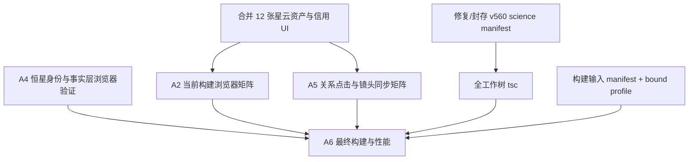

# Mainline A：后续开发规划（2026-09-12）

## 结论

当前主线 A 的成熟度是：**A1 已实现；A3 的 12 张扩展资产已完成权利审计、本地下载、生成 registry、场景 resolver、portrait fallback、当前元数据与信用覆盖；A5 的 5 条路线已静态覆盖全部 22 个当前对象并完成 M1↔蟹状脉冲星外部关系可逆浏览器闭环；A4 已修复 roster hero→passport 身份桥并完成六星桌面与 390×844 移动当前构建浏览器验证；A2、A5 全量视觉/点击覆盖仍部分合格；A6 仍阻塞发布**。历史线程 `01a0800d-3561-7c81-9a20-d72f126446cc` 的最后一轮被中断，不能当作完成信号。历史线程使用过 `C:\Users\86137\Documents\Codex\2026-09-10\new-chat-2`，本次实现以当前 `E:\86137\myai\solar_sim\next-web` 工作树重新生成所有构建、浏览器和哈希证据。

父目标继续保持不变：建立 Gaia 深空美术与知识层，同时不修改 EIH、Newton N-body、2PN/Lense–Thirring 和 Kerr 物理内核。新的视觉、来源、导航和性能代码只能读取物理状态，不能写回积分器、观测方程或步长策略。

## 当前证据与缺口

### 2026-09-12 首轮执行结果

已冻结 source-line identity，并在 `next-web` 生成 `mainlineANebulaVisualAssetsV607.all.generated.ts`：首批 6 张与扩展 6 张合计 12 条、3,324,626 bytes；场景 resolver、nebula portrait、A3 当前元数据和信用覆盖均已接入；A3 combined verifier 与 12 条静态信用逐项校验通过。A1 历史快照仍保持原有 6/12 语义。

最新 source-bound Lite build `h08Dhkk9omMt2ifEk6SBu`（input digest `d612c3f8188da9d9a3830e73c49fae433c98baa7812bb2eb3d353eddcaeeca2b`）已重新绑定相机 telemetry；此前 Rb2 的 A2/A4/A5/HTTP/性能浏览器收据保留为历史证据，必须在 h08 上重跑后才能成为当前矩阵。5 条路线静态覆盖 4 星座、6 恒星、12 星云和外部脉冲星；A6 性能继续保持 pending。

| 阶段 | 当前状态 | 已有证据 | 关闭条件 |
|---|---|---|---|
| A1 合同与盘点 | 已实现 | 合同、注册表、覆盖矩阵、`verify-mainline-a1.mjs`、45 个 Mainline A Vitest 和 9 个 Node 测试的历史记录 | 仅在接入扩展资产后重新生成当前树证据 |
| A2 常见星座 | Rb2 已完成桌面 stellar 四对象截图、移动 solar/stellar/galactic 标记与四对象直接选择，并留存桌面质量变体和移动截图 | Ori/UMa/Cas/Sco 的 IAU J2000 边界、共享亮星锚点、知识卡、401/111/118 几何 marker 收据 | 补资源生命周期与性能证据 |
| A3 星云美术 | 12/12 当前运行时已接入 | 12 张 CC BY 4.0 JPEG、3,324,626 bytes、A3 metadata/registry、12 条静态信用与 source hashes | 当前构建中 12 张均可见且信用完整；HTTP 已绑定 Rb2，性能仍需矩阵化验收 |
| A4 恒星 | 六星桌面与 390×844 移动浏览器证据已在 Rb2 验证 | 6 个事实分层、参数化肖像、不确定性面板、静态接触表、hero→passport resolver、移动几何收据 | 封存 Gaia 身份与误差边界；性能仍由 A6 统一验收 |
| A5 跨对象观测 | 相机 position/target/forward 已在 h08 验证；关系矩阵仍需 h08 重绑 | h08 camera telemetry receipt；Rb2 单边收据、五路线矩阵与 30-cycle resource identity 作为历史证据；23 个唯一目标静态覆盖 | 在 h08 重跑五路线、直接关系和 lifecycle；继续保持物理内核只读边界 |
| A6 性能与发布 | 未合格 | Lite 构建通过；bound profile 有输入 digest；Rb2 的 12 张 JPEG 均 HTTP 200、image/jpeg、字节数与 SHA-256 匹配；桌面/移动浏览器 frame budget 与资源快照已采样；证据 ZIP 可验 | 真实设备性能、长任务复核、最终 packet 和发布判定 |

当前工作树极度 dirty，且本地 checkout 与远端代码线不是同一来源：本地分支为 `codex/kerr-polarization-transport-v586`，实现路径是 `next-web`；GitHub 仓库 `wangyufanshuai/solar_sim` 的默认分支是仓库根目录 Next.js，最新合并提交为 `82af1d7`（2026-06-12），PR #5 `AAA Interface v5 NASA mission console` 仍是 draft。不要 reset、checkout、全量 staging 或删除。先在独立 worktree 中 fetch/对比远端 `main`、PR #5 和本地 `next-web`，形成 source-line map，再决定 A 主线落在哪条代码线上。

## 依赖关系

## 下一批次的执行顺序

### 0. 建立代码线与证据基线（先做）

1. 在隔离 worktree 中记录远端 `main`、PR #5 head、当前本地分支和 `next-web` 的 commit/tree hash；输出一份 `source-line-map`，列出 `app/`、`public/`、`scripts/`、`docs/` 的对应关系。
2. 选择唯一实现基线：若 A 主线继续留在 `next-web`，必须把它作为独立候选线并明确不会直接声称覆盖远端 root app；若迁移到 root app，则先做 A 资产/组件/证据的可重复移植，不能边迁移边验收。
3. 记录当前分支、工作树状态、Node/npm/Next 版本；所有输出写入新的 `tmp/mainline-a-v607-20260912-*` 目录。
4. 不采纳历史 build ID。重新运行 `node scripts/verify-mainline-a1.mjs`、扩展资产本地校验、定向 Vitest、定向 ESLint，并记录命令、退出码、输入 digest。
5. 为本批次建立唯一 `sourceManifestSha256`。任何浏览器、HTTP、性能 receipt 都必须包含该 digest、build ID、运行端口和时间范围。

### 1. A3 扩展资产运行时整合（已完成当前层）

目标对象：`ngc7293→opo0432d`、`ngc6543→potm2602b`、`ngc2237→potw1847a`、`ngc6960→heic1520a`、`carina→heic0707a`、`b33→heic0105a`。

- 已由 `materialize-mainline-a3-all-assets.mjs` 合并两份六张收据，生成 12 条 cleared 资产的单一 generated registry；脚本同时生成 12 条信用清单，禁止手改 generated 文件。
- 当前 A3 coverage、metadata、registry 与 combined verifier 已完成 12/12 计数、路径、字节数、SHA-256、尺寸、来源和信用文本校验；历史 A1 verifier/receipt 保留原语义。
- 检查 `mainlineANebulaSceneV607.ts` 的 resolver 对 12 个 catalog ID 均能返回 target；场景 caption 必须显示完整 credit、来源链接、CC BY 4.0 链接、波段和“二维/非肉眼/不代表三维”的边界说明。
- 加入 6 个扩展对象的 texture loader、取消、晚到 decode、重复 focus 和释放测试；验证研究模式、close-up、launch、Kerr gate 仍然抑制该 presentation layer。
- `CREDITS.md` 与 A3 combined acceptance 已生成；下一步只需把完整 12 对象浏览器/HTTP/性能证据绑定到同一最终 build。

### 2. A2/A4/A5 当前构建浏览器验收（第二优先级）

浏览器不可用时保持 pending，不能用 SSR、静态 PNG 或 HTTP 200 代替交互证据。恢复浏览器后使用同一 bound build 和固定端口，保存 DOM/runtime markers、截图和原始诊断。

- **A2**：桌面宽度和移动模拟宽度各跑 `qualityTier={mobile,balanced,dense}`、`lodTier={near,far}`，分别在 stellar 与 galactic 尺度检查 boundary/asterism 的 visible、opacity、segment count；覆盖图层开关、聚焦后返回和无几何数据。
- **A4**：六颗恒星逐一打开 passport，确认 observed、catalog-derived、model、artistic inference、uncertainty status 和 confidence level 的边界文案；确认肖像不会写入 simulation state；移动布局检查文字、来源和 SVG 不溢出。
- **A5**：从 Ori、M42、Betelgeuse、Rigel、Sco、Antares、M1、蟹状脉冲星等入口逐条点击关系按钮，记录 `selectedCatalogId`、passport object ID 与 `data-atlas-focus-command-*` 触发镜像；在实际 `controls.update()` 后另行写入并读取 `data-atlas-camera-actual-*`（position、target、forward），校验视线向量与相机/目标几何一致。重复返回路径，确认不会产生悬挂状态。
- 将三组结果写入独立 receipt：`a2-browser-matrix`、`a4-browser-matrix`、`a5-relation-browser-matrix`。每条观察都绑定 viewport、quality、LOD、build ID、开始/结束时间和 raw diagnostics。

### 3. A4 Gaia 身份与不确定性封存（与浏览器验收并行）

Gaia DR3 文档说明 `source_id` 在单个 Data Release 内使用，跨发布不能直接视为同一恒星；`parallax_error` 是视差标准误。因此：

- 为六颗命名恒星建立 `identityBinding`：名称/别名、发布（DR3/EDR3 等）、source_id、坐标邻近候选、匹配方法、匹配置信度和人工复核状态。
- 在没有 confirmed Gaia identity 的对象上继续显示 reference distance 或 literature model，但明确标为 curated/reference，不得套用 Gaia 误差。
- 封存 ADQL/归档查询、响应摘要、查询时间、发布版本和 SHA-256；将零点偏差修正是否采用写成显式策略。
- 只有 `identityBinding.status=confirmed` 且误差字段来自同一发布记录时，才把 `parallax_error` 进入用户可见测量层；否则保留 `unknown/not-recorded`。

### 4. A6 构建、性能和资源生命周期

- 使用 `scripts/build-mainline-a6-bound-profile.mjs` 的输入捕获机制；确认 build receipt 的 `candidateSourceManifestSha256` 等于本批次 manifest，且 listed inputs 在构建前后不变。
- 让 release packet 明确记录其 source manifest digest，并在构建前消费同一 manifest；解决当前“ZIP 与工作树一致但构建没有消费 ZIP”的 `sourceBinding=not-established` 问题。
- 以最终 bound build 启动 standalone/Lite 服务，检查入口与 12 张 JPEG 的 HTTP 200、content type、字节数和 SHA-256；当前 Rb2 结果见 `mainline-a6-http-assets-current-20260913.json`，记录了端口、distDir 和 build ID。
- 每个路径至少采集 overview、Orion constellation、M42 nebula、Betelgeuse stellar 四类场景；桌面目标 FPS≥55、移动模拟目标 FPS≥45、p95 frame time≤50 ms。记录至少 10 秒或 ≥241 帧、GPU adapter、canvas 数、资源计数和采样窗口。
- 对星云/恒星反复 focus 30 次，记录 texture lease、对象数量和堆斜率；现有历史上限 262,144 B/cycle 只能作参考，不能替代当前 build receipt。
- 当前 Rb2 浏览器采样见 `mainline-a6-browser-performance-current-20260913.json`：桌面 720 samples / 180.2 median FPS / 5.7 ms frame p95，移动 671 samples / 180.0 median FPS / 5.7 ms frame p95；两档资源快照均稳定且 console/page errors 为 0。长任务峰值仍需复核，且浏览器 emulation 不等于真实设备。
- 完成后再生成 `mainline-a-stage-a6-build.json`、性能 receipt、HTTP receipt、packet receipt 和最终 acceptance；任一项缺失都保持 `finalReleaseQualified=false`。

### 5. 全工作树 TypeScript 与 science manifest（独立门槛）

当前 `npx tsc --noEmit --incremental false` 因 v560 manifest 及其 v556→v559、v314 上游 science 产物链缺失而失败；核对结果见 `mainline-a6-science-manifest-blocker-20260913.json`。应从受信的历史产物恢复流程生成 v560 manifest，验证来源和哈希后再重跑全量 tsc。禁止创建空文件、复制不匹配版本或通过排除规则把失败改写成通过。若该流程暂时不可得，A6 只能标记“filtered production typecheck passed / full workspace blocked”。

## 与 GitHub 主线的整合策略

远端仓库已有成熟的 Deep Universe v4、Mission Operations v3 和 AAA Interface v5 视觉/性能审计惯例；这些 PR 的验证描述可以作为流程参考，但不能替代当前 A 主线的实测。建议先开一个只读比较任务，比较 `main`、PR #5 head 和本地 A 资产线，重点检查 `app/components/UniverseScene.tsx`、`app/components/GaiaStarField.tsx`、`app/components/ConstellationLines.tsx`、`app/lib/skyAtlas.ts`、`scripts/visual-acceptance.mjs` 与 `scripts/perf-assert.mjs`。完成 source-line map 后再决定是：

- **路线 R（推荐）**：以远端 `main` + PR #5 的 root app 为产品基线，把 A3/A4/A5 作为独立 feature slice 移植，并保留 `mainline-a-*` receipt；或
- **路线 L**：继续维护 `next-web` 作为研究候选线，明确远端 root app 只作为发布参考，等 A6 通过后再做一次受控迁移。

在没有 source-line map、统一 build receipt 和单一发布目标前，不要把本地 `next-web` 的 A6 结论写入 GitHub PR，也不要把 PR #5 的 60 场景声明当作 A 主线已经通过。

## 每轮交付格式

每个短轮次只解决一个验收问题，并留下：

1. 代码或数据增量；
2. 定向测试/Lint/HTTP 或浏览器命令；
3. 当前构建和来源身份；
4. 通过项、未执行项、阻塞项和下一轮入口；
5. 更新后的阶段 JSON，不提前提升状态。

## 完成判定

只有同时满足以下条件，主线 A 才能从“部分合格”进入可发布候选：12 个星云资产运行时可见且信用完整；A2/A4/A5 当前构建浏览器矩阵完成；A4 身份与误差边界封存；A6 构建输入 digest、HTTP、性能、30 次生命周期和 packet 全部绑定同一 build；全量 tsc 通过或有明确、可审计的 science manifest 阻塞记录。任何历史截图、旧 build、静态渲染、测试夹具或 ZIP 自洽都不能单独关闭这些门槛。

## 外部资料依据

- Gaia DR3 archive data model：[`gaia_source` 的 source_id、parallax 与 parallax_error 字段](https://gea.esac.esa.int/archive/documentation/GDR3/Gaia_archive/chap_datamodel/sec_dm_main_source_catalogue/ssec_dm_gaia_source.html)。
- Gaia DR3 documentation：发布版本、视差零点、DataLink 和归档查询边界（[官方文档](https://gea.esac.esa.int/archive/documentation/GDR3/index.html)）。
- IAU constellation boundary format and J2000 context（[官方星座说明](https://www.iau.org/Iau/Iau/Science/What-we-do/The-Constellations.aspx)）。

