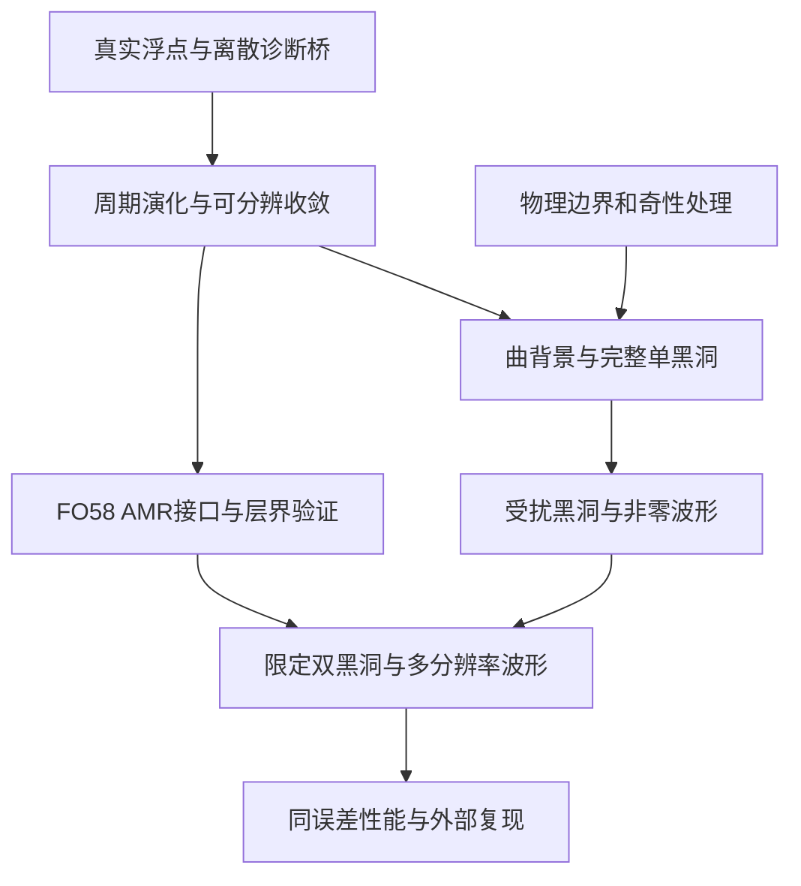

**广义相对论内核：剩余工期、交付层次与近期执行计划**

评估日期：2026-10-17，Asia/Tokyo。性质：基于当前源码、实验终态及官方外部基准的工程估计；不是新科学实验结果，也不是统计置信区间或完成日期保证。本次仅新增规划文档，没有重跑科学实验、改写冻结来源或变更资源合同。

我建议按三个交付层次安排投入：**可信单黑洞内核累计3–6个月；包含限定双黑洞案例的研究内核累计9–18个月；在明确指标上达到一流水平并完成外部复现，按18–36个月或更长规划。** 近期2–4周应先交付真实浮点与周期演化验证版。若目标收窄到一个边界、AMR约束控制或同误差性能问题，12–24个月内形成有竞争力的研究成果可以作为冲刺目标，不能替代完整顶层目标。

所有时间从恢复持续开发的T0算起，均为累计日历时间，不应逐行相加。当前goal工具返回paused；本文没有恢复自动调度。历史10月14日总规划中的“下一次先做P0”已经过时；本次续接点是10月15日的实际诊断桥之后。

估计假设：一名主开发者配合AI并行，每周约25–35小时有效开发、实验与审查；复用当前Python/C++实现；大型实验前有适合的计算与存储资源；关键边界和波形结论能够取得外部专业复核。不假设AI运行24小时就能线性压缩科学研究时间，也不把同一模型的多次审查当外部复现。若只在零散时间推进，日历时间会相应拉长；若始终受当前小批资源合同约束，不能给完整BBH可信交期。

**当前基线与真正剩余的工作**

本次重新读取最新qualification gate，并将其中696项source_after摘要与当前文件逐一比较，全部一致。最新正式结果仍为10月15日，未发现新的binary64正式批次。

* 最新gate：`285b84e81940b3465853a4752d1b7db4319a4bf2f6b4216998968e4669165c51`，passed/completed=true、errors=[]。
* 已确认的是固定case12、连续体实数公式解释下的完整约束一阶变化；原运行138项控制、13张矩阵、206,707个位置，两路终态审计通过。
* actual_binary64_rhs_executed、new_scientific_evolution、physical_boundary_validated和live_admission仍为false。
* 本次没有重新执行这些控制或全量重审历史目录；历史成功范围取自对应封存记录。

| 能力 | 当前可复用成果 | 剩余主要工作 |
| --- | --- | --- |
| 方程与诊断 | 固定背景完整58状态/43物理约束的精确来源桥、全方向及能量适用域证据 | 原NumPy浮点、真实离散导数、时间推进及更广背景上的数值验收 |
| 原生计算 | C++ OpenMP体积项、SBP/SAT、RK4、方法绑定checkpoint和若干真实中断恢复控制 | 变化后的方法对等、大网格成本、长程恢复；无需重新从零移植C++ |
| 单黑洞 | N13 Schwarzschild局部外域`[1,3]^3`、T=1/8续算证据 | 覆盖黑洞的完整域、puncture或合法excision、外边界、视界/质量诊断及可分辨收敛；旧时间阶仍unresolved |
| AMR | BSSN/CCZ4双层subcycling、局部patch/ghost同步组件 | 当前FO58方法的动态层级、阶段时间插值、重网格、跨层约束误差和恢复；现有proxy接口不能直接升级 |
| 辐射与双黑洞 | 视界/ADM/Psi4和ell=2序列组件；时间对称双穿刺初值 | 非零物理波形、多半径误差、含轨道动量的相容初值、旋近/合并与独立比较 |

来源：[最新诊断结果](E:/86137/myai/solar_sim/next-web/science/numerical_relativity/RESULTS-20261015-case12-actual-constraint-diagnostic.md)、[原生续算](E:/86137/myai/solar_sim/next-web/science/numerical_relativity/RESULTS-20261011-native-gauge-continuation-v2.md)、[局部AMR边界](E:/86137/myai/solar_sim/next-web/science/numerical_relativity/amr_patch3d.py:1)、[excision当前范围](E:/86137/myai/solar_sim/next-web/science/numerical_relativity/excision3d.py:1)、[三维初值与观测组件](E:/86137/myai/solar_sim/next-web/science/numerical_relativity/nr3d.py)。

不按代码行数、脚本数、通过测试数或聊天轮数报整体完成百分比。当前成果主要降低公式和装配错误风险，尚未关闭强场演化的主要风险。

**累计排期与验收条件**

| 阶段 | 累计规划窗口 | 可交付结果 | 必须成立的验收条件 |
| --- | --- | --- | --- |
| A 实际浮点与周期演化 | 2–4周；出现数值问题时4–8周 | 一个可重复的真实周期演化基线 | 完整登记浮点桥、两路实际复算和真实负控；随后分离时间/空间误差，保存58状态与43约束；未完成或不可分辨就不晋级 |
| B 数值方法资格与黑洞入口 | 1–3个月，与边界研究并行 | 多分辨率周期测试、曲背景有限窗口、完整单黑洞候选入口 | 至少三档适当分辨率、可分辨的时间步研究、对应Python/C++检查；明确强场适用域和内外边界方案 |
| C 可信的限定单黑洞 | 3–6个月 | 具有误差账本和恢复能力的完整单黑洞研究版本 | 真正覆盖黑洞；内外边界相容；质量/视界/约束随分辨率、边界距离和演化时长验证；8–12周只作为顺利情况下的冲刺目标 |
| D 动态3D AMR与非零辐射 | 5–9个月 | 限定FO58 AMR、弱波与受扰单黑洞ringdown | 阶段一致ghost、子循环/时间插值、重网格和checkpoint；层界反射/约束注入；非零信号的多分辨率、多半径误差 |
| E 限定双黑洞研究版本 | 9–18个月 | 正碰，继而限定等质量/低自旋准圆轨道、合并和ringdown | 约束相容初值、偏心率/junk记录、波形收敛、质量角动量核算、外部代码物理量对齐；不覆盖任意质量比/极端自旋 |
| F 顶层科研目标 | 18–36个月或更长，低确定性 | 明确问题上的精度、稳定性或同误差计算成本优势，及外部复现 | 锁版本独立重建、第三方结果、完整误差预算和失败域；公开基准上的可复现优势，不能用功能齐全替代 |

阶段F的时间不是“到期自然一流”。需要一个可证伪的研究贡献：例如FO-CCZ4边界/AMR层界的约束误差控制，或者指定误差下的异构后端总成本优势。如果只做到与成熟框架相当而没有新优势，可以交付合格研究内核，不能自动改名为顶级成果。

研究反例可能迫使边界、规范或奇性处理路线重新设计，以上区间不覆盖无限返工。基线估计本身已包含正常调试和有限修订；出现方法级反例时重新排期，不简单加一个统一百分比。

**关键路径与可并行项**

周期Cauchy验证可以先走，不等待一般CPBC问题全部解决。有限域黑洞阶段再与边界路线汇合。AMR的单元与弱波接口可提前开发，但在单黑洞及层界验证前不宣称动态AMR黑洞求解器已经通过。

保留一个方程/方法负责人；另外并行推进独立数值验证、边界推导和外部基准准备。资源受限的科学批次一次只启动一个，避免并行任务改变负载和来源。多个agent不同时修改主算子。

近期不追加与当前数值问题无关的形式证书；需要新的推导时说明它具体关闭哪个演化、边界或适用域缺口。保留已有证明，不重复从零推导。GPU、GRMHD、辐射转移、宇宙学、多年太阳系星历和浏览器美术不进入本轮主线；它们不是这份真空NR工期的一部分。

**前四周具体交付**

以下按T0后的有效开发周安排，不表示已执行。

| 时间 | 工作与输出 | 退出条件 |
| --- | --- | --- |
| 第1周 | 将[浮点候选备忘录](E:/86137/myai/solar_sim/next-web/science/numerical_relativity/NOTE-20261015-case12-binary64-periodic-bridge-next.md)变成正式协议；实现生产/独立计算和小型控制 | 数值门、全场误差传播、重放容差、逐文件预算全部冻结；实际源路径、两阶差分、全部58列都在登记内 |
| 第2周 | 运行唯一登记批次，封存结果；通过后接周期RK4短窗 | 482次生产+482次独立state evaluations完整；全模式、零槽、目标外变化、不可分辨项和两种真实变异均核验；失败则交付具体反例和原因，不跨过失败门 |
| 第3周 | 时间步和网格细化分开验证；实测每步成本、峰值内存和输出量 | 固定问题、共同终点和至少三档适当分辨率；时间误差、空间误差、舍入和小振幅非线性分别记账；不以观测阶不可分辨宣称高精度 |
| 第4周 | 固定可重复的周期基线；准备曲背景与单黑洞候选；评审内外边界路线 | 可重建运行、约束随时间曲线、状态/诊断误差、恢复检查、可用CFL与成本报告；完成下一阶段资源与方法决策 |

第1–2周的964次state evaluations包含1928次完整RHS/diagnostic调用，其600秒可行性尚未实测。所有测试、独立复算、封存和输出均受正式合同约束；不在外面偷偷预跑一次，也不因超时换小矩阵后拼成通过。

首月目标是可解释、可复现的实际演化证据。黑洞视频或波形图可以辅助观察，但不单独作为通过标准。若桥接在前两周失败，后两周用于定位和经新协议登记的修正候选，首月里程碑相应顺延。

**资源条件和时间估计的适用边界**

2026-10-17本机只读查询：i9-13900HX，24核/32逻辑处理器，15.81GiB物理内存，RTX 4060 Laptop GPU；C盘约9.62GiB、E盘约25.96GiB瞬时余量。未测试GPU数值能力、显存可用量、Linux/MPI环境或实际大规模吞吐，因此不从设备名称推算加速倍数。

58个float64变量的单份均匀场：64³为116MiB，128³为928MiB；若仅按8份同尺寸驻留缓冲估计，分别约0.90625GiB与7.25GiB，实际还有几何/导数/ghost/诊断和系统开销。这是数组体积计算，不是实测内存峰值。

当前600秒/64MiB是已登记小批合同，其中64MiB是总磁盘输出限制。64³单份完整58变量快照就超出该输出额度。后续需要这种快照或长期演化时，必须另行制定适当实验、预算、存储和恢复合同，不能在旧合同里默默放宽。当前保护、旧失败和旧证据原样保留；本规划没有购买或租用任何资源。

算力条件应在单黑洞扩大实验前实测：有效cell-updates/s、RHS/步骤耗时、峰值RAM、输出/封存占比和一次恢复成本，再推下一档资源。固定物理域的三维显式网格每轴加倍，基础网格量约8倍、相同CFL下步数约2倍，基础成本可能接近16倍；AMR、实现和通信会改变实际倍率。

外部量级参考：[Einstein Toolkit的GW150914官方示例](https://einsteintoolkit.org/gallery/bbh/)记录特定N=28发布算例约98GB、128核2.8天、8700核时。它使用旧Xeon平台，提供最后六圈轨道与并合相关数据。这说明完整BBH实验有独立的运行/存储成本；不是我们的硬件报价，也不是开发工期模型。

[GRChombo官方README](https://github.com/GRTLCollaboration/GRChombo/blob/main/README.md)将MPI/OpenMP和Chombo AMR作为独立基础设施。[FO-CCZ4原论文](https://arxiv.org/abs/1707.09910)分别报告波测试、曲背景收敛、单puncture长时演化及初步正碰BBH。由这些资料推得的规划判断是：AMR、强场、波形和外部比较必须分别验收；它们不提供本项目剩余开发月数的统计依据。

**如何提速和滚动重估**

1. 先交付真实浮点到周期演化的闭环，复用现有C++和恢复组件；有实际数值反馈后再扩展背景和物理范围。
2. 只设一个主科学里程碑。每周报告新增可验证能力、主要反例、运行成本和下一缺口；不以新增文件/测试数衡量项目完成率。
3. 外部求解器先用一个：优先锁版本的ET参考案例。对齐单位、初值、规范与观测量，不同时移植多个大型框架。
4. 科学缺口与工程缺口分开处理：实现错误可修复后另立候选；不可分辨需重新设计实验；方法反例需重新评估路线。旧失败不被覆盖或自动重跑。
5. 两周后用浮点桥的真实结果重估A/B；周期基线后用吞吐与收敛重估C；完整单黑洞后再冻结AMR/BBH的大实验资源与交付承诺。每次估计写明条件变化，不把暂停、排队和外部审阅等待隐藏成研发时间。

如果目标是尽快拥有可展示且有科学依据的成果，首个发布目标应是“固定范围、可重建、带误差和失败域的周期/单黑洞研究版本”。它可以早于顶层目标交付。完整目标仍保留：限定适用域的正确性、稳定性、黑洞/AMR/非零波形、双黑洞、等精度性能及独立复现；shadow-only、legacy可回滚、scientificPayloadWriteback=false继续有效。
